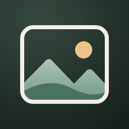
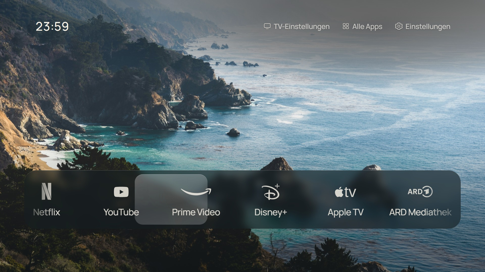

# CleanFrame Deutsch



Eine ruhige, deutschsprachige App-Startseite für Samsung-TVs: deine Apps, ein Hintergrundbild und die Uhrzeit.

Dieser Fork von **[nthnclrk/CleanFrame](https://github.com/nthnclrk/CleanFrame)** basiert auf der Arbeit von **Nathan Clark**. Er passt CleanFrame an einen **Samsung GU43TU8079UXZG mit Tizen 5.5** an – keinen The Frame. Die Fork-Version **0.6.3** baut auf Upstream-Commit `58ac92a` auf; ihre Versionsnummern sind unabhängig von späteren Upstream-Releases.



## Änderungen gegenüber dem Original

- Deutsche Oberfläche einschließlich Einstellungen, Hinweisen, Zugänglichkeitsbeschriftungen und Hintergrundbildnamen.
- Uhrzeit im **24-Stunden-Format**, einschließlich führender Null: `09:07`.
- Sieben vorausgewählte Apps: Netflix, YouTube, Prime Video, Disney+, Apple TV, ARD Mediathek und ZDF.
- Weiße ARD- und ZDF-Logos passend zu den übrigen App-Symbolen.
- Eigenes CleanFrame-App-Icon mit Bilderrahmen, Landschaft und Sonne statt des bisherigen „F“.
- **TV-Einstellungen statt Art Mode** für den Fernseher ohne Frame-Funktionen.
- Manifest-Mindestversion Tizen 5.5 und ergänzte Filter für System-Apps.
- Windows-Unterstützung im Browser-Testwerkzeug. Die alten Python-npm-Befehle und der Signierprozess sind nicht vollständig auf Windows portiert; siehe unten.

Die vorhandenen Listen-/Leistenlayouts, Hintergrundbilder, öffentlichen Schriftarten und lokalen Einstellungen bleiben erhalten. Gespeicherte App-Auswahl und Reihenfolge haben Vorrang vor den sieben Vorgaben. Die Startseite bietet weiterhin Platz für maximal neun Apps.

## Was tatsächlich auf dem TV funktioniert

| Bereich | Ergebnis |
| --- | --- |
| Gerät | Samsung GU43TU8079UXZG, Tizen 5.5 / ARMv7, Firmware `T-NKLDEUC-2743.0` |
| Installation | Mit eigener Samsung-App-Identität und eigenen Zertifikaten installiert; bis Fork-Version 0.6.3 aktualisiert |
| Oberfläche | Darstellung, Pfeiltasten-Navigation und Netflix-Start vom Besitzer bestätigt |
| Anpassungen | Deutsche Oberfläche, 24-Stunden-Uhr, ARD-/ZDF-Logos und neues Icon in Samsungs App-Liste bestätigt |
| Physische Home-Taste | **Nicht umgestellt**; öffnet weiterhin Samsungs Oberfläche |
| Fester Autostart | **Nicht eingerichtet** |
| Weitere TV-Modelle | Nicht durch diesen Fork verifiziert |

**Dies ist eine eigenständige App, kein fertiger Ersatz für Samsungs System-Launcher.** Das Verlassen von Netflix kann weiterhin zur Samsung-Oberfläche führen. Home-Taste, Autostart, Root und Firmware wurden nicht verändert. Die native Untersuchung wurde pausiert; sie ist keine Installationsvoraussetzung.

Die vorhandenen nativen Upstream-Helfer sind für andere Geräte und Firmwarestände abgesichert. Nicht auf diesem TV ausführen oder ihre Schutzprüfungen entfernen. Eine App-Sicherung ist außerdem **kein vollständiges TV-Systembackup**.

Details und getrennte Upstream-Ergebnisse stehen in [Kompatibilität](docs/compatibility.md). Nutzung auf eigene Verantwortung; es gibt keine allgemeine Kompatibilitäts- oder dauerhafte Laufzeitgarantie.

## Browser-Vorschau

Voraussetzungen: Node.js **22.13+ aus der 22er-LTS-Reihe oder 24+**, Python **3.10+**.

```sh
git clone https://github.com/jooonaaassssss/CleanFrame.git
cd CleanFrame
npm ci
```

**Windows / PowerShell:**

```powershell
$env:PYTHONUTF8 = '1'
python scripts\preview.py --public-fonts
```

**macOS / Linux:**

```sh
npm run dev:public
```

Öffne [localhost:4795/home/](http://localhost:4795/home/). Pfeiltasten, Eingabe und Escape entsprechen Navigation, OK und Zurück. Die Vorschau steuert keinen Fernseher. App-Starts funktionieren erst auf einem eingerichteten TV.

Alle benötigten Bilder, Logos und öffentlichen Schriftarten sind enthalten; kostenpflichtige Schriftarten sind nicht erforderlich.

## Auf dem eigenen Fernseher installieren

Es gibt hier **keine persönlichen Signierschlüssel und kein universell installierbares signiertes Paket**.

1. Zunächst die Browser-Vorschau und die [Kompatibilitätsgrenzen](docs/compatibility.md) prüfen.
2. Samsungs offizielle TV-Entwicklungswerkzeuge verwenden und eine **eigene, SDK-generierte Paket-/App-ID** sowie eigene Autor-/Distributorzertifikate anlegen. Das Distributorzertifikat muss den eigenen TV abdecken.
3. Die persönlichen Werte ausschließlich lokal halten. Für die bestehenden macOS-/Linux-Paketwerkzeuge dient [signing.example.json](signing.example.json) als Vorlage für die ignorierte `.local/signing.json`. Unter Windows mit den offiziellen Samsung-Werkzeugen vorbereiten und signieren.
4. Vor Veränderungen den eigenen Ausgangszustand und die Schlüssel sichern. Installation und sichtbare Funktion am eigenen Gerät prüfen.
5. Bei Updates dieselbe eigene App-ID und dasselbe Autorenzertifikat beibehalten, damit keine zweite App entsteht. Eine vorherige Deinstallation ist normalerweise nicht nötig und kann Einstellungen löschen.

Der [Entwicklungsleitfaden](docs/development.md#local-tv-tools-and-signing) beschreibt die Werkzeuge. Der ausführliche [Upstream-TV-Leitfaden](docs/agent-tv-setup-guide.md) enthält zusätzlich Frame-spezifische und native Schritte; er ist **kein ungeprüft ausführbarer Installer für diesen Fork**.

Der öffentliche Export behält die Referenzidentität des Quellcodes. Er ist eine **unsignierte Ausgangsbasis**, kein fertig für deinen TV vorbereitetes Paket. Vor einer Installation die eigene Identität verwenden und selbst signieren.

Nach der Installation benötigt die App keinen laufenden Entwicklungs-PC. Schlüssel, Passwörter und Wiederherstellungskopien für spätere Updates behalten.

## Prüfen und bauen

Die Browserprüfungen verwenden nur lokale Chromium-Profile und eine Vorschau auf dem eigenen PC, keinen echten TV.

**Windows / PowerShell:**

```powershell
npm run lint
$env:PYTHONUTF8 = '1'
python scripts\check.py
node --test scripts\test-device.mjs
npx playwright install chromium
$env:CLEANFRAME_PUBLIC_FONTS = '1'
node scripts\check-browser.mjs
python scripts\check-public.py
python scripts\export-public.py
```

**macOS / Linux:**

```sh
npm run check
npm run check:tools
npx playwright install chromium
CLEANFRAME_PUBLIC_FONTS=1 npm run check:browser
npm run check:public
npm run export:public
```

Die Signierwerkzeug-Tests benötigen POSIX-Module und laufen deshalb nicht unter Windows; die GitHub-Actions-Prüfung verwendet Linux. Es ist nicht erforderlich, dafür WSL einzurichten.

Der Export erzeugt `dist/CleanFrame-public-unsigned.wgt` mit öffentlichen Schriftarten und Lizenzhinweisen. Persönliche Pakete, Testberichte und lokale Konfigurationen bleiben ignoriert. Das App-Icon lässt sich nach Installation von Chromium mit `node scripts/build-app-icon.mjs` aus seiner SVG-Quelle neu erzeugen.

Weitere Informationen: [Entwicklung](docs/development.md), [Tests](docs/testing.md), [Bedienung](docs/interaction-behaviour.md), [Asset-Erzeugung](docs/assets.md) und [Veröffentlichungsprüfung](docs/public-release.md). Weiterführende Upstream-Dokumentation ist überwiegend englisch.

## Lizenz, Quellen und Datenschutz

- Der ursprüngliche Code steht unter der **[MIT-Lizenz](LICENSE)**. Nathan Clarks Copyright- und Lizenztext bleiben unverändert enthalten. Die Code-/Dokumentationsänderungen dieses Forks und das neue App-Icon werden ebenfalls unter MIT bereitgestellt.
- Drittmaterial ist **nicht pauschal MIT**: Manrope, Geist und Newsreader verwenden SIL OFL 1.1; die Fotos die Unsplash License; die Service-Logos die in [THIRD_PARTY_NOTICES.md](THIRD_PARTY_NOTICES.md) genannten MIT-/CC0-Quellen.
- ARD stammt aus dem MIT-lizenzierten Custom-Brand-Icons-Projekt, ZDF aus Simple Icons unter CC0. Quellen und Anpassungen sind bei den Assets dokumentiert. Markenrechte bleiben bei den jeweiligen Inhabern.
- Beim Weitergeben die Lizenztexte, Copyright-Hinweise und Asset-Quellen beibehalten. Kostenpflichtige Pangram-Schriftdateien sind nicht Bestandteil dieses Forks.
- Keine Zertifikate, Schlüssel, Passwörter, Kontotokens, persönlichen Gerätekennungen, Netzwerkadressen, Backups oder signierten TV-Pakete veröffentlichen.

CleanFrame und dieser Fork sind unabhängig von Samsung, ARD, ZDF und den übrigen genannten Diensten. Es besteht keine behauptete Unterstützung oder Partnerschaft. Beiträge sind unter Beachtung von [CONTRIBUTING.md](CONTRIBUTING.md) willkommen.
